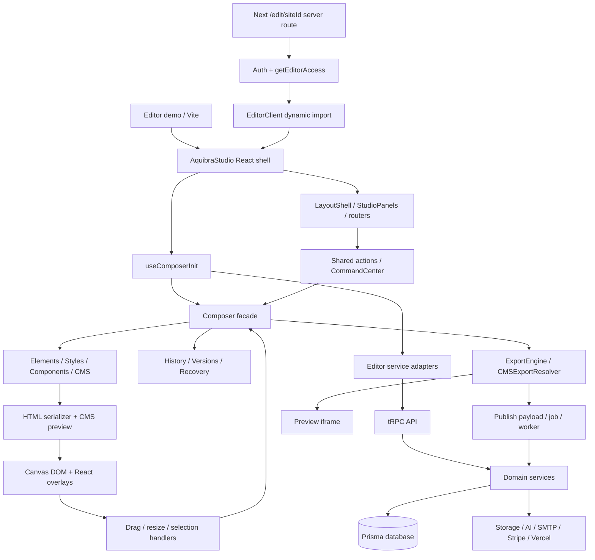
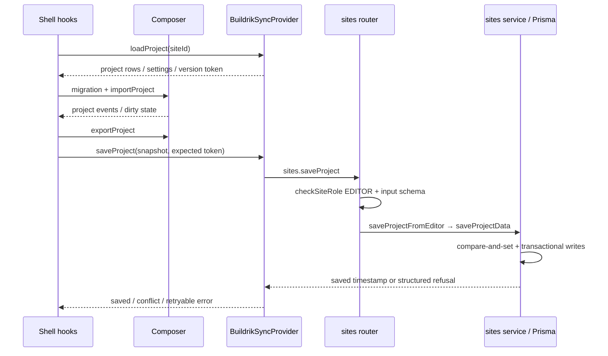

# Phase 1 — Actual architecture and discovery evidence

Scope: the accessible Buildrick repository. This is discovery, not an approved redesign. Paths in this report are repository-relative. Historical comments and earlier reports are leads; implementation and import/route evidence take precedence.

## Baseline and method

The exact commit, tracked paths, route inventory, model inventory and source-area counts are in [repository-manifest.json](evidence/repository-manifest.json). Five existing modified menu/test files predate the master prompt; their hashes and patch are preserved in `evidence/prior-working-tree.json` and `prior-menu-change.patch`. No application files were changed during this read-only phase. Runtime evidence must distinguish these working-tree menus from the original commit.

The inventory contains 3,270 tracked TS/TSX/JS/MJS/CSS/Prisma files across the selected application areas, **including tests and configuration**, not 3,270 reviewed implementations. It includes 2,413 editor-src files, 472 dashboard files, 83 shared-package files, 243 server files, 55 root-lib files, 3 Prisma files and 1 demo entry. The manifest lists 148 Next page/layout/route files and 72 database models. Router source files are not synonymous with registered domains: use `server/trpc/router.ts` to establish registration.

The TypeScript AST [import graph](evidence/import-graph.json) records 13,645 import/re-export edges, 9,140 resolved local edges and 200 literal dynamic imports. Unresolved imports, event registration, generated styles, URL routes and configuration-driven use are not proof of dead code. No file has been declared unused from this graph.

## Codebase architecture map

## Entry points, framework and routing

- `packages/editor/demo/main.tsx` mounts AquibraStudio directly with a development-only Composer probe and Agentation. `vite.config.ts` sets demo root, Tailwind/React plugins and `/api` proxy to the dashboard. This local harness is not an authenticated production-route test.
- `packages/dashboard/app/edit/[siteId]/page.tsx` authenticates, checks `getEditorAccess`, preserves query deep links through login, and redirects viewers to read-only presentation. Backend role enforcement remains independent.
- `packages/dashboard/components/editor-route/EditorClient.tsx` dynamically imports `@buildrik/editor` with SSR disabled and keys the editor by siteId. It handles chunk-load errors distinctly. Keying is essential to avoid carrying one site's Composer into another route.
- `packages/editor/src/index.ts` exports the engine, shell and draft-preview helpers. Its header claiming no exports/consumers is stale: package exports and EditorClient demonstrate consumption. Do not use this comment to remove the barrel.
- `packages/dashboard/next.config.mjs` transpiles the editor package. `packages/editor/src/shared/utils/runtimeEnv.ts` bridges environment access; Vite-only imports cannot be assumed safe in Next.
- Next 16/React 19, Vite, Tailwind 4 and Flowbite are declared in package manifests. Versions here describe declared constraints, not an independently verified deployment lockfile.
- The Next app also contains auth, onboarding, dashboard, share/review token, integration callbacks, uploads, SSE, cron and worker routes. Full paths are inventoried, including routes outside the editor brief.

## Component dependency and module ownership map

| Owner | Existing responsibilities | Principal evidence | Important dependents / audit boundary |
|---|---|---|---|
| Shell | Lifecycle, project context, overlays, preview, panel coordination | `editor/shell/AquibraStudio.tsx`, `StudioPanels.tsx`, hooks | All workspaces; preserve site remount and async load semantics |
| Navigation/layout | Rail definitions, left and right modes, full workspaces | `editor/rail/tabsConfig.ts`, `LayoutShell.tsx/.css`, `sidebar/TabRouter.tsx`, `FullPageRouter.tsx` | Role gates, deep links, panel-return state |
| Canvas presentation | Serialized document, selection/hover/drag overlays | `editor/canvas/Canvas.tsx`, hooks | Engine is document authority; React chrome is not the customer DOM |
| Inspector | Capability-aware sections and property controls | `editor/inspector/sections/registry`, `config/sectionOrder.ts` | Element capabilities, token registries, breakpoint writes |
| Shared element actions | Common inspector/menu operations and eligibility | `editor/shared/elementActions.ts` | Context menu adapter and inspector menus; commands own mutations |
| Engine facade | Coordinates managers, events, project import/export, transactions | `engine/Composer.ts` constructor and transaction methods | All editor modules; do not replace during IA work |
| Element/state engine | Tree, selection, styles, viewport, commands | `engine/elements`, `SelectionManager.ts`, `styles`, `Viewport.ts`, `commands` | Drag, resize, undo and export all depend on these contracts |
| Local recovery/history | JSON-patch undo, checkpoints, saved versions, storage | `HistoryManager.ts`, `VersionTimelineManager.ts`, `storage`, `recovery` | Session undo is not the same as remote saved version or deployment rollback |
| Reusable systems | Component masters, media, brand tokens/presets, fonts | `engine/components`, `media`, `designSystem`, editor workspaces | Local and remote stores, usage tracking, propagation |
| Structured content | Collection/record state, bindings, dynamic pages, import | `engine/cms`, `editor/cms`, `services/cmsSync.ts` | Canvas resolution, export resolution, API data; separate persisted stores |
| Output | HTML/CSS/assets and runtime injection | `engine/export`, `shell/exportPublishPages.ts`, `PreviewOverlay.tsx` | Preview and deployed output need independent parity checks |
| Editor remote adapters | Credentialed API client, project/media/CMS/component sync | `services/api-client.ts`, `BuildrikSyncProvider.ts` and domain adapters | API contracts, conflict/recovery, role changes |
| Shared contracts | Zod schemas, markup allowlist, tokens, content identity | `packages/shared/schemas`, `tokens`, `content` | Both client/server; backwards compatibility is cross-package |
| Dashboard | Auth/product/admin UI, editor host, share/review screens | `packages/dashboard/app`, `components` | Owns different Tailwind prefix rules from editor |
| API orchestration | Registered tRPC domain routers and REST endpoints | `server/trpc/router.ts`, `trpc.ts`, Next `app/api` | Session/bearer/role/feature gates; no UI-only permission assumptions |
| Domain services | Business rules, data writes, external services | `server/services` | Prisma transaction boundaries, quotas, publishing and emails |
| Persistence | Relational identity/permissions plus JSON document payloads | `prisma/schema.prisma` | Project page trees, site settings/styles, CMS records, components, versions |

Editor-relative paths in this table live below `packages/editor/src/`. Detailed static edges, including dynamic imports, are available in the graph; the diagram above groups them by runtime responsibility rather than drawing thousands of file nodes.

## State and data flow map

### Authoring and rendering

Composer initializes ElementManager, StyleEngine, CommandCenter, SelectionManager, HistoryManager, VersionTimelineManager, StorageAdapter, Viewport, component/media/form/recovery/migration systems and grouped CMS/canvas/collaboration managers. It is an event-emitting facade, not a React global-state replacement candidate.

UI state lives in React hooks such as `useStudioState`; some preferences persist separately. CMS navigation uses `cmsWorkspaceStore` with `useSyncExternalStore`. Brand exposes separate token/preset registry contexts. These are different scopes; apparent multiple stores are not automatically duplicate document state.

`useCanvasSync` serializes `composer.elements.toHTML()` and coalesces project events through requestAnimationFrame. `useCanvasContent` resolves CMS preview content. Canvas injects this HTML and renders editor overlays separately. Therefore an inspector control can update the model correctly while serializer/CSS/output behavior still diverges.

### Drag and resize

Canvas wires `useCanvasDragDrop` for insertion and `useCanvasElementDrag` for existing-node operations; drag delegates onto the container so DOM replacement does not remove every handler. Auto-scroll, DOM drop feedback and snap calculations are separate hooks. Keyboard reordering flows through commands; gesture and shortcut parity must be tested.

`useCanvasResize` passes element ID, handle, client coordinates and modifier state to `composer.canvas.resize.startResize` with transactions. ResizeHandler obtains DOM bounds, tracks a transient state, updates DOM in animation frames, and commits through resize DOM/model helpers. ResizeOrchestrator applies handle math, aspect ratio, centre mode, snapping, size constraints and parent boundaries. Coordinate conversion across canvas zoom is a required investigation: source geometry uses boundingClientRect, while DOMUpdater writes pixel dimensions. This is a hypothesis until a controlled live gesture confirms it.

### Undo and recovery

HistoryManager uses patches, periodic full checkpoints and a 500ms coalescing window. Transactions and flush behavior affect what one Undo means. It also marks non-recorded actions so Undo does not deceptively undo an unrelated older change. Async feature mutations and remote record writes need separate checks; a local Undo pass does not validate cloud persistence.

### Project load/save

`useSaveCallback` distinguishes saved, queued-offline, conflict and error. `useComposerInit` owns load/migration and remote autosave integration, with retry classification. BuildrikSyncProvider tracks loaded sites and conflicts; it refuses replacing a remote project that never loaded. Local StorageAdapter exists separately. Do not infer production persistence from standalone “Saved.”

### Publish

The editor generates output through export helpers; `usePublishJob` sends pages and polls status. `server/trpc/routers/sites.ts:publish` checks EDITOR, with ADMIN for acknowledging stale approval; `startPublish` owns further approval/freshness/quota/job rules. `publish.service.ts:dispatchWorker` triggers `/api/workers/publish/[jobId]`; the Next worker builds/deploys, and status is observable through polling/SSE. Rollback is another deployment job, not just local undo. No deployment was triggered during discovery.

## Authentication, permission and data boundaries

`server/auth.ts` initializes NextAuth from auth.config; OAuth providers and JWT session callbacks are present. `trpc.ts:createTRPCContext` combines cookie session and optional bearer authentication; a bearer token takes restrictive precedence and invalid supplied tokens fail closed. `protectedProcedure` denies bearer use; `scopedProcedure` checks declared token scope. Site/workspace checks remain downstream responsibilities.

`permission.service.ts` verifies ACTIVE workspace membership, per-site grants and role overrides; owner/admin workspace scope differs from limited members. `guardSiteRole` and `guardSiteAccess` are separate. `requireWorkspace` resolves the session workspace with membership fallback. These inspected contracts do not certify every endpoint's authorization; endpoint-by-endpoint role testing remains pending.

Prisma defines users/workspaces/memberships/site permissions; sites with project styles/settings/assets/bindings; page trees; CMS collections/entries; media/folders/versions; component masters/templates; reviews/comments; saved site versions/deployment jobs; billing/subscriptions; integrations/webhooks/tokens; notifications/activity/audit; AI jobs/usage; forms/submissions; transfers/deletion/scheduling. Full names are in the manifest. No schema or stored document changes are proposed in Phase 1.

## Existing design-system assessment

Editor chrome composes `@/editor/chrome-ui`, Flowbite wrappers, `tw:` Tailwind utilities and generated `--bk-*` tokens. Site content styles are a separate concern. Entry CSS includes `themes/default.css`, generated tokens, chrome resets, design-system/site-content CSS and accessibility styles. Brand's user-authored tokens must not be conflated with editor chrome tokens.

Dashboard primitives and unprefixed application Tailwind coexist with a prefixed Flowbite stylesheet. Dashboard instructions document why some controls are custom primitives. A wholesale framework replacement is not justified by this discovery.

The earlier conformance run reported 36/302 active boards measured, known drift and template-only anchor matches. Those checks bound regressions; they do not establish complete visual or interaction fidelity. The earlier audit's visual proposals remain unapproved and are not an AS-IS Figma reconstruction.

## Architectural risks / deeper investigation

| Risk | Evidence / confidence | Required investigation |
|---|---|---|
| Host differences | Two entry paths and environment bridge — confirmed | Compare authenticated Next and demo behavior, flags, storage and CSS |
| Snapshot/state divergence | Multiple serializer/export paths — confirmed architecture | Reproduce responsive output, CMS, runtime interactions across canvas/preview/deployment |
| Geometry coordinate mismatch | Screen bounds/client deltas → CSS pixels — hypothesis | Resize at50%,100%,150%, including zero-delta/cancel and parent constraints |
| Cross-surface action divergence | Shared registry plus canvas selection handlers — confirmed | Eligibility and history parity for locked/root/multi-selection |
| Routing/focus fragmentation | Panel/fullpage config plus right-column/CMS/asset special modes — confirmed | Escape, tab order, saved drafts and return context for every host family |
| Persistent data compatibility | JSON documents/tokens, migrations, CAS saves — confirmed | Never infer a presentation refactor permits schema changes; characterize reload/conflict/migration failures |
| Authorization coverage | Shared guards exist, endpoint coverage not proven | Owner/editor/viewer and token scope matrix with disposable authenticated fixtures |
| Event-driven dependencies | Static import graph does not encode all events | Trace command/event IDs and config registries before declaring unused code |
| Multiplayer readiness | Explicit engine production restriction | Keep gate intact; convergence, reconnect, permission and undo audit separately |
| Performance | Serialized canvas and large facade; no measured regression claim | Large-tree selection/typing/drag traces and output timings before optimization |

## Discovery gate

Major accessible module families are inventoried and ownership/entry/data paths are traced. Leaf-level functionality remains unverified; see the feature ledger. The gate is limited to discoverability, not “every line reviewed” or “every feature functional.” Required next work is behavioral verification of canvas gestures, complete local workflows, all surface families, and authenticated integrations.
